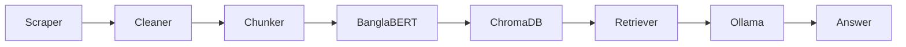

# BanglaMed-RAG


A retrieval-augmented generation system for Bengali biomedical QA, built with Bangla-BERT and local LLMs.

## Why This Matters
Bangla has 230M+ speakers, yet high-quality medical QA tools remain scarce. This repo shows a full, local, zero-paid-API RAG stack that can run offline for low-resource medical settings.

## What You Get
- End-to-end pipeline: scrape → clean → chunk → embed → retrieve → answer
- Local LLMs via Ollama (phi3 or llama3.2:3b)
- A 50-question Bengali medical QA benchmark with retrieval metrics (BM25 vs dense) and RAGAS evaluation
- FastAPI + Streamlit for deployment-ready UX
- Tests, linting, Docker, and CI for production-quality hygiene

## Architecture


## Results

### Retrieval (50-question Bengali medical benchmark)
Each question in [`data/qa_benchmark.json`](data/qa_benchmark.json) has a gold context passage. All 50 passages form the search corpus, and a retriever scores a hit when it ranks the question's own passage in the top *k*.

| Retriever | Hit@1 | Hit@3 | Hit@5 | MRR |
| --- | ---: | ---: | ---: | ---: |
| BM25 (lexical baseline) | **0.50** | **0.70** | **0.80** | **0.631** |
| `sagorsarker/bangla-bert-base` (mean-pooled, used in the pipeline) | 0.46 | 0.64 | 0.68 | 0.568 |
| `paraphrase-multilingual-MiniLM-L12-v2` | 0.18 | 0.36 | 0.42 | 0.321 |

**What this shows:**
- **A plain BM25 baseline beats both dense retrievers on this benchmark.** Bangla-BERT is a masked-language model, not a sentence-embedding model, so mean-pooling its outputs gives weak semantic vectors.
- **The multilingual sentence model does even worse on Bengali medical vocabulary.**
- **The next steps are hybrid BM25 + dense retrieval, or fine-tuning a Bengali sentence encoder.**

With only 50 questions, a difference of 0.02 is a single question, so treat small gaps as noise. Reproduce with `python -m banglamed_rag.retrieval_eval`; raw numbers are in [`data/retrieval_results.json`](data/retrieval_results.json).

### Generation (RAGAS)
End-to-end RAGAS scores (faithfulness, answer relevancy, context precision and recall) require a local Ollama model as the judge and have not been published yet. Run `python -m banglamed_rag.evaluator` to compute them.

## Quickstart (Docker)
```bash
git clone https://github.com/sillyfellow21/BanglaRagNLP.git
cd BanglaRagNLP
cp .env.example .env
docker-compose up --build
```
Open Streamlit: http://localhost:8501

Pull a local model inside the Ollama container:
```bash
docker-compose exec ollama ollama pull phi3
```

To run the FastAPI service instead of Streamlit:
```bash
docker-compose run --service-ports app uvicorn app.api:app --host 0.0.0.0 --port 8000
```
FastAPI docs: http://localhost:8000/docs

## Local Development (No Docker)
```bash
python -m pip install -e ".[dev]"
ollama pull phi3
python -m banglamed_rag.scraper
python -m banglamed_rag.cleaner
python -m banglamed_rag.vectorstore
python -m banglamed_rag.retrieval_eval   # retrieval benchmark, no LLM needed
python -m banglamed_rag.evaluator        # RAGAS, needs Ollama
streamlit run app/streamlit_app.py
```

## Configuration
- `OLLAMA_BASE_URL` (default `http://localhost:11434`)
- `OLLAMA_MODEL` (default `phi3`)
- `EMBEDDING_MODEL` (default `sagorsarker/bangla-bert-base`)
- `CHROMA_PERSIST_DIR` (default `./chroma_db`)
- `CHUNK_SIZE` / `CHUNK_OVERLAP`
- `TOP_K`

If you run outside Docker, set `OLLAMA_BASE_URL=http://localhost:11434` in your `.env`.

## Data Notes
- Raw pages are saved in `data/raw/` (gitignored).
- Cleaned chunks are saved in `data/processed/corpus_clean.jsonl` (gitignored).
- Benchmarks live in `data/qa_benchmark.json` (committed).

## Citation
- sagorsarker/bangla-bert-base
- RAGAS
- LangChain
- ChromaDB
